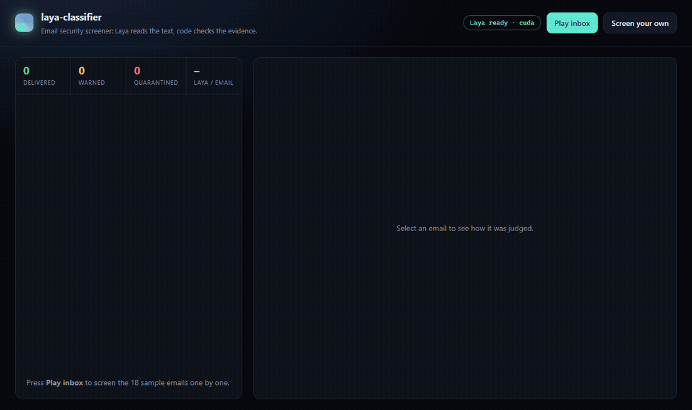
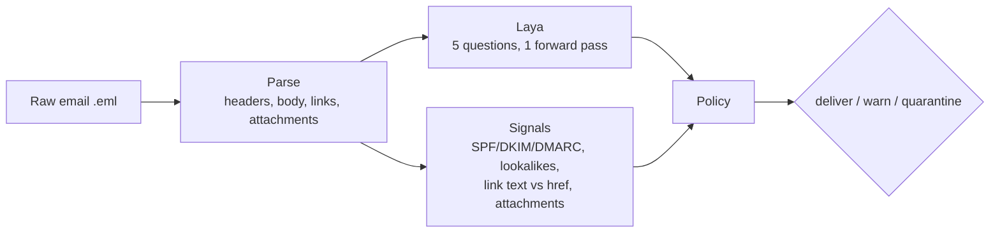

# laya-classifier

An email security screener built on [Laya](https://github.com/NandhaKishorM/laya), the open-weights
decision model. Laya reads the text and answers five typed questions in one forward pass; plain code
checks the headers, links and attachments; a small policy turns both into a verdict: **deliver**,
**warn** or **quarantine**, with the reasons.



It runs locally on a GPU (about 60 ms per email for all five questions) or on a CPU, in English and
Portuguese: Laya's router sends each email to the checkpoint that reads its language.

## How it works



**Laya reads what only a language model can.** For every email it answers, in one pass
([`questions.py`](src/laya_screener/questions.py)):

| Question | Type | Answer |
|---|---|---|
| Is it phishing or a scam? | `noul` | probability |
| What does it try to get the reader to do? | `choice` | credential theft, payment fraud, malware, ordinary |
| How much pressure does it apply? | `score` | none, a normal deadline, urgency or secrecy |
| Does it ask for a sign-in or a password? | `noul` | probability |
| Does it ask to move money or change bank details? | `noul` | probability |

**Code checks what a model shouldn't guess** ([`signals.py`](src/laya_screener/signals.py)):
failed SPF, DKIM or DMARC; a sender or link on a lookalike of a protected domain (`n0rthwind`,
`fabrikam-billing`, punycode); link text that shows one domain and opens another; a Reply-To on
another domain; a display name that borrows an internal identity; bare-IP and shortened links;
attachments that can run code (`.exe`, `.html`, macro documents) or that hide behind a double
extension (`Scan.pdf.exe`).

**The policy combines them** ([`policy.py`](src/laya_screener/policy.py)):

- Laya's risk is the higher of the broad phishing answer and a *social engineering* score:
  (asks for money or a sign-in) × (probability of urgency or secrecy). The narrow questions catch
  what the broad one misses: on the sample inbox the English checkpoint gives a CEO wire-fraud
  email 3% on "is it phishing?", but 89% on "asks to move money" with 74% "urgency or secrecy".
- A decisive signal (a disguised link, an executable or HTML attachment) quarantines on its own.
- Any other high-severity signal quarantines when Laya is at least somewhat suspicious (≥ 0.3).
- Laya alone quarantines when its risk reaches 0.5.
- Anything else suspicious gets a warning; the rest is delivered.
- Authenticated mail (DMARC pass) from a protected or trusted domain, whose links all stay on known
  domains, counts Laya's risk at half weight, so a password reset you asked for isn't flagged.

## Results

Measured with `python eval/evaluate.py` on an RTX 5050 laptop GPU over the 18 labeled emails in
[`samples/`](samples) (10 attacks, 8 legitimate; 12 English, 6 Portuguese). Full per-email table in
[`docs/evaluation.md`](docs/evaluation.md).

| Screener | Attacks flagged | Legitimate mail flagged |
|---|---|---|
| Signals only | 5/10 | 0/8 |
| Laya only | 6/10 | 0/8 |
| **Combined** | **9/10** | 1/8 (a mailing list whose Reply-To differs, labeled *warn*) |

16 of 18 verdicts match the labels exactly, and no legitimate email is quarantined. The fake
e-signature notice is warned instead of quarantined, and the one attack delivered is a file-share
"proposal" from a domain that authenticates and imitates nothing: only its text gives it away, and
Laya reads it as ordinary.

| Checkpoint | Emails | Median Laya latency, RTX 5050 laptop | Median Laya latency, i7-14650HX CPU |
|---|---|---|---|
| `laya` (English) | 12 | 62 ms | 2.1 s |
| `laya-multilingual` | 6 | 30 ms | 0.66 s |

This is a small, hand-made inbox. It shows how the parts work together, not how the screener does
on real mail, and the thresholds were chosen on it. Label a few hundred of your own emails and
refit them before trusting a verdict.

## Quickstart

Python 3.10 or newer. For a GPU, install the PyTorch build for your CUDA version first
([pytorch.org](https://pytorch.org/get-started/locally/)); an RTX 50-series card needs CUDA 12.8:

```bash
python -m venv .venv
.venv/bin/python -m pip install torch --index-url https://download.pytorch.org/whl/cu128   # GPU only
.venv/bin/python -m pip install -e ".[dev]"
```

On Windows use `.venv\Scripts\python.exe`. The first run downloads the Laya checkpoints from
Hugging Face (about 800 MB for English, 650 MB for multilingual).

```bash
laya-screener serve                 # dashboard and API on http://127.0.0.1:8000
laya-screener screen samples/*.eml  # screen files from the terminal
laya-screener screen mail.eml --json
laya-screener --device cpu serve    # pin the device (cuda, cpu, mps)
```

Open the dashboard and press **Play inbox** to watch the sample inbox get screened, or **Screen your
own** to paste an email.

### Docker (CPU)

```bash
docker build -t laya-classifier .
docker run -p 8000:8000 -v laya-hf:/root/.cache/huggingface laya-classifier
```

The volume keeps the downloaded checkpoints between runs.

## API

| Method | Path | Body | Returns |
|---|---|---|---|
| `GET` | `/api/health` | | `{ready, device, version}` |
| `POST` | `/api/screen` | `{"raw": "<.eml source>"}` or `{"from", "subject", "body"}` | a result |
| `POST` | `/api/screen/batch` | `{"emails": [ ...up to 100 of the above ]}` | a list of results |
| `GET` | `/api/samples` | | the sample inbox |
| `POST` | `/api/samples/{file}/screen` | | a result |

```bash
curl -s localhost:8000/api/screen -H 'content-type: application/json' -d '{
  "from": "Maria Chen <maria.chen.office@freemail.example>",
  "subject": "Urgent and confidential",
  "body": "I need you to wire $48,200 before 3 pm today. Keep this between us."
}'
```

A result carries the `verdict`, a 0-100 `risk`, human-readable `reasons`, every `signal`, Laya's
answers with their probabilities, the checkpoint that read the email and its latency. Interactive
docs are at `/docs`.

## Configuration

[`config/screener.json`](config/screener.json) says who the screener protects: your own domains,
the partners attackers imitate, internal names and executives whose names appear in spoofed display
names. Point `LAYA_SCREENER_CONFIG` at another file to use your own.

## Tests and evaluation

```bash
pytest                      # parser, signals, policy and API, with a fake model (no download)
python eval/evaluate.py     # the real checkpoints over the labeled inbox; writes docs/evaluation.md
```

## Limits

- **Zero-shot.** The shipped Laya checkpoints aren't trained on phishing. Laya's own docs say
  fine-tuning on your domain is where accuracy jumps, and it ships a fine-tuning notebook.
- **The English checkpoint is weak on broad yes/no questions**, a limit Laya documents; this project
  works around it with narrow questions instead of fixing it.
- **Laya's confidences aren't calibrated for this task.** Thresholds here are policy choices from 18
  emails, not properties of the model.
- **No sandboxing.** Links aren't followed and attachments aren't opened; the checks read names,
  types and headers only.
- **Trusted origin can be abused** by a compromised internal account: authenticated internal mail
  gets a lighter reading.

The samples are fictional, on reserved `.example` domains.

## Credits

Built on [Laya](https://github.com/NandhaKishorM/laya) by ConvAI Innovations (Apache 2.0), with its
[`laya`](https://huggingface.co/convaiinnovations/laya) and
[`laya-multilingual`](https://huggingface.co/convaiinnovations/laya-multilingual) checkpoints.
